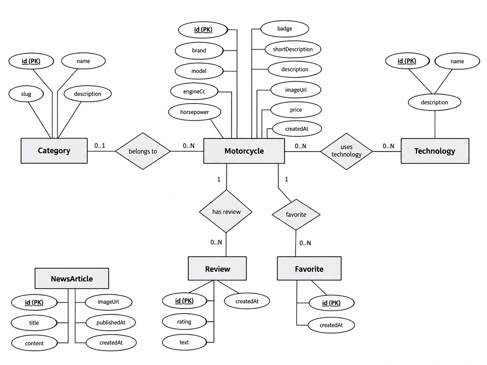
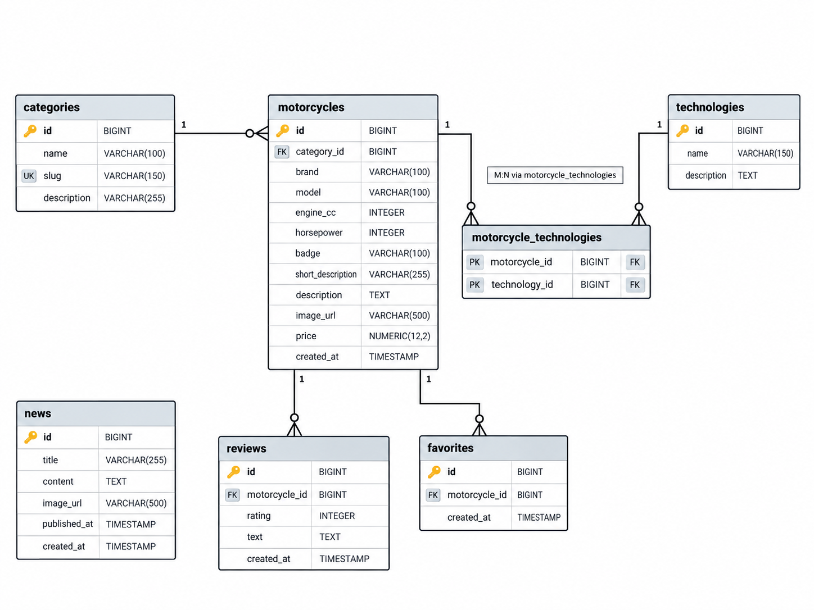

# Лабораторная работа № 4 — Проектирование базы данных MotoRide

**Дисциплина:** Технологии web-программирования  
**Тема:** «Разработка и проектирование базы данных»  
**Проект:** MotoRide — каталог мотоциклов с категориями, технологиями, отзывами, избранным и новостями.

## 1. Цель работы

Изучить взаимодействие web-приложения с реляционной базой данных; выбрать СУБД; спроектировать логическую и физическую структуры данных; установить связи между сущностями; рассмотреть ORM-модели приложения и построить ER-диаграммы.

шесть Java-классов `Category.class`, `Favorite.class`, `Motorcycle.class`, `NewsArticle.class`, `Review.class`, `Technology.class`.

## 2. Выбор системы управления базами данных

СУБД: PostgreSQL.

## 3. Взаимодействие web-приложения с БД

Модели из проекта написаны **на Java с Jakarta Persistence API (JPA)**. Аннотации `@Entity`, `@Table`, `@Id`, `@Column`, `@ManyToOne`, `@ManyToMany`, `@JoinColumn` и `@JoinTable` позволяют ORM-провайдеру сопоставлять Java-объекты и строки SQL-таблиц. При использовании Spring Data JPA операции чтения и записи обычно через репозитории, а ORM-провайдером может быть Hibernate.

Например, в репозитории для мотоциклов достаточно объявить:

```java
public interface MotorcycleRepository extends JpaRepository<Motorcycle, Long> {
    List<Motorcycle> findByBrand(String brand);
}
```

Затем приложение может вызвать `repository.findByBrand("Yamaha")`, а Spring Data JPA при наличии соответствующей конфигурации сформирует SQL-запрос и преобразует записи в объекты `Motorcycle`.

## 4. Структура базы данных

По моделям определены **6 сущностей** и **7 таблиц**.

| Таблица | Назначение | Основные поля |
|---|---|---|
| `categories` | Категории мотоциклов | `id` PK, `name`, `slug` UNIQUE, `description` |
| `motorcycles` | Каталог мотоциклов | `id` PK, `category_id` FK, `brand`, `model`, `engine_cc`, `horsepower`, `badge`, `short_description`, `description`, `image_url`, `price`, `created_at` |
| `technologies` | Справочник технологий | `id` PK, `name`, `description` |
| `motorcycle_technologies` | Связь мотоциклов и технологий M:N | `motorcycle_id` FK, `technology_id` FK; составной PK в проектном DDL |
| `reviews` | Отзывы о мотоциклах | `id` PK, `motorcycle_id` FK, `rating`, `text`, `created_at` |
| `favorites` | Избранные мотоциклы | `id` PK, `motorcycle_id` FK, `created_at` |
| `news` | Новостные публикации | `id` PK, `title`, `content`, `image_url`, `published_at`, `created_at` |

### 4.1. Внешние ключи и кратности

| Главная таблица | Дочерняя таблица | Связь | Основание |
|---|---|---|---|
| `categories` | `motorcycles` | 0..1 : 0..N | `Motorcycle.category` — `@ManyToOne` без `optional=false`; категория для мотоцикла не обязательна |
| `motorcycles` | `reviews` | 1 : 0..N | `Review.motorcycle` — `@ManyToOne(optional=false)` |
| `motorcycles` | `favorites` | 1 : 0..N | `Favorite.motorcycle` — `@ManyToOne(optional=false)` |
| `motorcycles` | `motorcycle_technologies` | 1 : 0..N | Внешний ключ `motorcycle_id` в таблице связи |
| `technologies` | `motorcycle_technologies` | 1 : 0..N | Внешний ключ `technology_id` в таблице связи |

### 4.2. ER-диаграммы

**ER-диаграмма в нотации Чена**



**ER-диаграмма в нотации «воронья лапка» (Crow's Foot)**




```java
package com.web.motoridelab3api.model;

import jakarta.persistence.Column;
import jakarta.persistence.Entity;
import jakarta.persistence.FetchType;
import jakarta.persistence.GeneratedValue;
import jakarta.persistence.GenerationType;
import jakarta.persistence.Id;
import jakarta.persistence.JoinColumn;
import jakarta.persistence.JoinTable;
import jakarta.persistence.ManyToMany;
import jakarta.persistence.ManyToOne;
import jakarta.persistence.Table;
import lombok.AllArgsConstructor;
import lombok.Getter;
import lombok.NoArgsConstructor;
import lombok.Setter;

import java.math.BigDecimal;
import java.time.LocalDateTime;
import java.util.List;

@Entity
@Table(name = "motorcycles")
@Getter
@Setter
@NoArgsConstructor
@AllArgsConstructor
public class Motorcycle {

    @Id
    @GeneratedValue(strategy = GenerationType.IDENTITY)
    private Long id;

    @ManyToOne(fetch = FetchType.LAZY)
    @JoinColumn(name = "category_id")
    private Category category;

    @Column(nullable = false, length = 100)
    private String brand;

    @Column(nullable = false, length = 100)
    private String model;

    @Column(name = "engine_cc", nullable = false)
    private Integer engineCc;

    @Column(nullable = false)
    private Integer horsepower;

    @Column(length = 100)
    private String badge;

    @Column(name = "short_description", length = 255)
    private String shortDescription;

    @Column(columnDefinition = "text")
    private String description;

    @Column(name = "image_url", length = 500)
    private String imageUrl;

    @Column(precision = 12, scale = 2)
    private BigDecimal price;

    @Column(name = "created_at", nullable = false, updatable = false)
    private LocalDateTime createdAt;

    @ManyToMany(fetch = FetchType.LAZY)
    @JoinTable(
        name = "motorcycle_technologies",
        joinColumns = @JoinColumn(name = "motorcycle_id"),
        inverseJoinColumns = @JoinColumn(name = "technology_id")
    )
    private List<Technology> technologies;
}
```

```sql
CREATE TABLE motorcycle_technologies (
    motorcycle_id BIGINT NOT NULL REFERENCES motorcycles(id),
    technology_id BIGINT NOT NULL REFERENCES technologies(id),
    PRIMARY KEY (motorcycle_id, technology_id)
);
```
