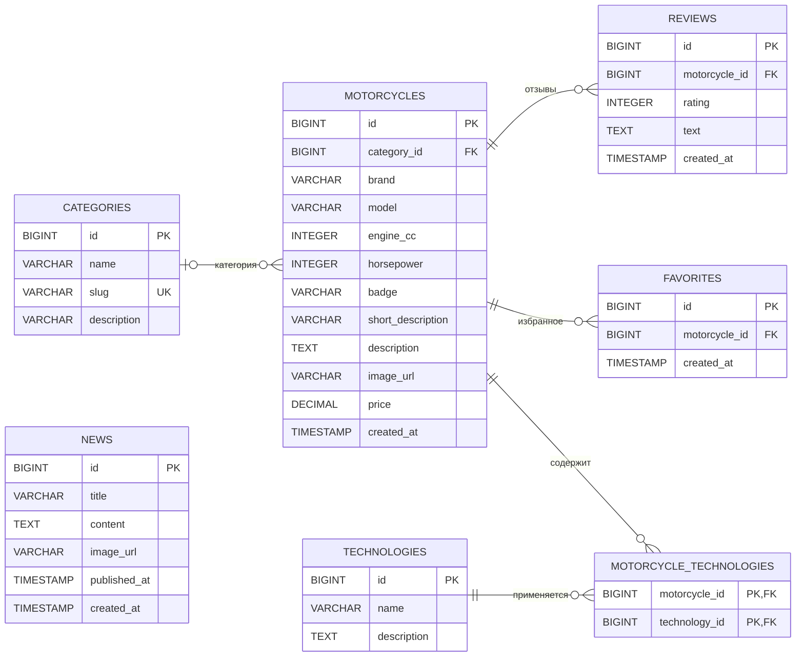

# Лабораторная работа № 4 — Проектирование базы данных MotoRide

**Дисциплина:** Технологии web-программирования  
**Тема:** «Разработка и проектирование базы данных»  
**Проект:** MotoRide — каталог мотоциклов с категориями, технологиями, отзывами, избранным и новостями.

## 1. Цель работы

Изучить взаимодействие web-приложения с реляционной базой данных; выбрать СУБД; спроектировать логическую и физическую структуры данных; установить связи между сущностями; рассмотреть ORM-модели приложения и построить ER-диаграммы.

> **Основа анализа:** шесть переданных скомпилированных Java-классов `Category.class`, `Favorite.class`, `Motorcycle.class`, `NewsArticle.class`, `Review.class`, `Technology.class`. Таблицы, названия полей, длины, связи и аннотации были восстановлены из байткода JPA. Наличие запущенной базы данных, выбранного на практике JDBC-драйвера и миграций по этим файлам подтвердить нельзя. `schema.sql` — спроектированный вариант PostgreSQL, согласованный с этими сущностями, а не выгрузка из реальной БД.

## 2. Выбор системы управления базами данных

**Предлагаемая СУБД: PostgreSQL.** Она является реляционной, бесплатно распространяется, поддерживает первичные и внешние ключи, уникальные ограничения, транзакции и индексы. Для MotoRide это удобно: у мотоцикла есть категория, отзывы и избранное, а также набор технологий, реализуемый отдельной таблицей связи.

В таблицах используются `BIGINT` (идентификаторы), `VARCHAR(n)` (короткий текст), `TEXT` (длинный текст), `INTEGER` (числовые характеристики), `NUMERIC(12,2)` (цена) и `TIMESTAMP` (дата-время). Java-тип `LocalDateTime` соответствует `TIMESTAMP WITHOUT TIME ZONE` в выбранном SQL-проекте.

## 3. Взаимодействие web-приложения с БД

Модели из проекта написаны **на Java с Jakarta Persistence API (JPA)**. Аннотации `@Entity`, `@Table`, `@Id`, `@Column`, `@ManyToOne`, `@ManyToMany`, `@JoinColumn` и `@JoinTable` позволяют ORM-провайдеру сопоставлять Java-объекты и строки SQL-таблиц. При использовании Spring Data JPA операции чтения и записи обычно выполняются через репозитории, а ORM-провайдером может быть Hibernate.

Например, в репозитории для мотоциклов достаточно объявить:

```java
public interface MotorcycleRepository extends JpaRepository<Motorcycle, Long> {
    List<Motorcycle> findByBrand(String brand);
}
```

Затем приложение может вызвать `repository.findByBrand("Yamaha")`, а Spring Data JPA при наличии соответствующей конфигурации сформирует SQL-запрос и преобразует записи в объекты `Motorcycle`.

**Об Eloquent из методички:** Eloquent — ORM фреймворка Laravel на PHP. В переданном коде Eloquent не используется, поэтому в данной лабораторной рассматривается его функциональный аналог для Java — JPA / Spring Data JPA. Это не означает, что в проект добавлялся Laravel.

## 4. Структура базы данных

По моделям определены **6 сущностей** и **7 таблиц** (включая таблицу реализации связи многие-ко-многим).

| Таблица | Назначение | Основные поля |
|---|---|---|
| `categories` | Категории мотоциклов | `id` PK, `name`, `slug` UNIQUE, `description` |
| `motorcycles` | Каталог мотоциклов | `id` PK, `category_id` FK, `brand`, `model`, `engine_cc`, `horsepower`, `badge`, `short_description`, `description`, `image_url`, `price`, `created_at` |
| `technologies` | Справочник технологий | `id` PK, `name`, `description` |
| `motorcycle_technologies` | Связь мотоциклов и технологий M:N | `motorcycle_id` FK, `technology_id` FK; составной PK в проектном DDL |
| `reviews` | Отзывы о мотоциклах | `id` PK, `motorcycle_id` FK, `rating`, `text`, `created_at` |
| `favorites` | Избранные мотоциклы | `id` PK, `motorcycle_id` FK, `created_at` |
| `news` | Новостные публикации | `id` PK, `title`, `content`, `image_url`, `published_at`, `created_at` |

### 4.1. Внешние ключи и кратности

| Главная таблица | Дочерняя таблица | Связь | Основание |
|---|---|---|---|
| `categories` | `motorcycles` | 0..1 : 0..N | `Motorcycle.category` — `@ManyToOne` без `optional=false`; категория для мотоцикла не обязательна |
| `motorcycles` | `reviews` | 1 : 0..N | `Review.motorcycle` — `@ManyToOne(optional=false)` |
| `motorcycles` | `favorites` | 1 : 0..N | `Favorite.motorcycle` — `@ManyToOne(optional=false)` |
| `motorcycles` | `motorcycle_technologies` | 1 : 0..N | Внешний ключ `motorcycle_id` в таблице связи |
| `technologies` | `motorcycle_technologies` | 1 : 0..N | Внешний ключ `technology_id` в таблице связи |

**Итог:** `Motorcycle` ↔ `Technology` — связь **многие-ко-многим (M:N)** через `motorcycle_technologies`. Таблица `news` автономна, потому что в присланных моделях у неё нет внешних ключей. Сущности `User` в загруженных классах нет: избранное не связано с конкретным пользователем, и искусственно добавлять таблицу `users` было бы некорректно.

## 5. ER-диаграммы

### 5.1. Концептуальная ER-диаграмма в нотации Чена (академический вариант)

Нотация Чена использует **прямоугольники для сущностей**, **ромбы для отношений** и **овалы для атрибутов**. На схеме показаны основные атрибуты, а полный состав столбцов — на следующей диаграмме. Строгой универсальной «ER-нотации по ГОСТ», тождественной нотации Чена, нет: здесь она применяется как традиционное академическое оформление схемы для отчёта, а не ошибочно объявляется отдельным ГОСТ-стандартом.


[Открыть изображение PNG](docs/er_chen.png) · [Открыть SVG](docs/er_chen.svg)

### 5.2. Физическая ER-диаграмма в нотации «воронья лапка» (Crow's Foot)

Эта схема описывает **таблицы, SQL-типы полей, первичные ключи (PK), внешние ключи (FK), уникальный ключ (UK)** и кратности отношений. Она подходит для документации структуры, аналогичной той, которую можно просматривать в инструментах баз данных, в том числе JetBrains DataGrip. Следует учитывать: DataGrip строит диаграммы из метаданных SQL-базы и не обязательно отображает именно Crow's Foot-символы.


[Открыть изображение PNG](docs/er_crows_foot.png) · [Открыть SVG](docs/er_crows_foot.svg)

Исходный код диаграммы на Mermaid (GitHub поддерживает рендеринг ER-диаграмм):



**Обозначения:** `||` — ровно один объект; `o|` — ноль или один; `o{` — ноль или множество. Например, одна категория содержит 0..N мотоциклов, а конкретный мотоцикл может быть связан с 0..1 категорией.

## 6. Описание ограничений и нормализация

В JPA-моделях указаны следующие ограничения:

- Поле `id` каждой основной сущности — `@Id`, генерируется как `GenerationType.IDENTITY`.
- Поле `categories.slug` обязательно, уникально и имеет длину до 150 символов.
- Поля `brand` и `model` обязательны (`VARCHAR(100)`), как и `engine_cc` и `horsepower`.
- `reviews.rating`, `news.title`, `news.content` обязательны.
- Значение цены хранится с точностью `NUMERIC(12,2)`; в присланной модели оно не помечено `nullable=false`.
- Временные поля `created_at` / `published_at` помечены `nullable=false` и `updatable=false` там, где они используются.
- Обязательность ссылок из `Review` и `Favorite` на `Motorcycle` указана через `@ManyToOne(optional=false)`.

Разделение каталога на справочники `categories` и `technologies` устраняет повторение одинаковых категорий и технологий в каждой записи. Отношение M:N вынесено в отдельную таблицу. Модель соответствует типичному нормализованному проектированию; формальную 3НФ по одним объявлениям JPA без анализа всех функциональных зависимостей утверждать нельзя.

В SQL-файле **дополнительно предложены** составной первичный ключ таблицы `motorcycle_technologies` и индексы по внешним ключам. Такие решения логичны при создании PostgreSQL-схемы, но их фактическое наличие в БД невозможно доказать только по `.class`.

## 7. Пример модели приложения — Motorcycle.java

Ниже представлена **семантически эквивалентная реконструкция** модели по компилированному `Motorcycle.class`. Исходного `.java` файла не было, поэтому оформление Lombok-аннотаций может отличаться от исходника, но поля и JPA-связи соответствуют байткоду.

```java
package com.web.motoridelab3api.model;

import jakarta.persistence.Column;
import jakarta.persistence.Entity;
import jakarta.persistence.FetchType;
import jakarta.persistence.GeneratedValue;
import jakarta.persistence.GenerationType;
import jakarta.persistence.Id;
import jakarta.persistence.JoinColumn;
import jakarta.persistence.JoinTable;
import jakarta.persistence.ManyToMany;
import jakarta.persistence.ManyToOne;
import jakarta.persistence.Table;
import lombok.AllArgsConstructor;
import lombok.Getter;
import lombok.NoArgsConstructor;
import lombok.Setter;

import java.math.BigDecimal;
import java.time.LocalDateTime;
import java.util.List;

@Entity
@Table(name = "motorcycles")
@Getter
@Setter
@NoArgsConstructor
@AllArgsConstructor
public class Motorcycle {

    @Id
    @GeneratedValue(strategy = GenerationType.IDENTITY)
    private Long id;

    @ManyToOne(fetch = FetchType.LAZY)
    @JoinColumn(name = "category_id")
    private Category category;

    @Column(nullable = false, length = 100)
    private String brand;

    @Column(nullable = false, length = 100)
    private String model;

    @Column(name = "engine_cc", nullable = false)
    private Integer engineCc;

    @Column(nullable = false)
    private Integer horsepower;

    @Column(length = 100)
    private String badge;

    @Column(name = "short_description", length = 255)
    private String shortDescription;

    @Column(columnDefinition = "text")
    private String description;

    @Column(name = "image_url", length = 500)
    private String imageUrl;

    @Column(precision = 12, scale = 2)
    private BigDecimal price;

    @Column(name = "created_at", nullable = false, updatable = false)
    private LocalDateTime createdAt;

    @ManyToMany(fetch = FetchType.LAZY)
    @JoinTable(
        name = "motorcycle_technologies",
        joinColumns = @JoinColumn(name = "motorcycle_id"),
        inverseJoinColumns = @JoinColumn(name = "technology_id")
    )
    private List<Technology> technologies;
}
```

Ключевые аннотации: `@Entity` — сущность БД; `@Table` — таблица `motorcycles`; `@Id` и `@GeneratedValue` — первичный ключ; `@ManyToOne` — категория мотоцикла; `@ManyToMany` и `@JoinTable` — связь с технологиями через `motorcycle_technologies`. Значение `FetchType.LAZY` означает отложенную загрузку связанных объектов.

Файл модели также находится по пути [`src/main/java/com/web/motoridelab3api/model/Motorcycle.java`](src/main/java/com/web/motoridelab3api/model/Motorcycle.java).

## 8. SQL-структура

Готовый проектный DDL для PostgreSQL: [`schema.sql`](schema.sql). Файл создаёт все семь таблиц, внешние ключи, уникальный ключ `categories.slug` и индексы отношений.

Пример создания связующей таблицы:

```sql
CREATE TABLE motorcycle_technologies (
    motorcycle_id BIGINT NOT NULL REFERENCES motorcycles(id),
    technology_id BIGINT NOT NULL REFERENCES technologies(id),
    PRIMARY KEY (motorcycle_id, technology_id)
);
```
